# Requirements pipeline

A generic pipeline of Claude agents and deterministic checks. It turns messy
business sources (meeting transcripts, portal screenshots, live web
calculators) into a **feature spec**: each feature (e.g. employee onboarding) is
specified in one spec that holds its user stories, grouped in sections, with
acceptance criteria and concrete examples, every line traceable to a
source quote. The spec says **what** is needed and **why**. It contains no
technical decisions; how to build it is up to engineering.

```mermaid
flowchart LR
    S1["<b>1 Sources</b><br/>transcripts · screenshots · calculator<br/>→ quotable units"]
    S2["<b>2 Extract</b><br/>atomic facts<br/>with verbatim quotes"]
    S3["<b>3 Verify</b><br/>quotes checked by code<br/>facts checked by a judge"]
    S4["<b>4 Knowledge model</b><br/>information, rules<br/>gaps → open questions"]
    S5["<b>5 Feature spec</b><br/>one feature, sections of stories,<br/>Given/When/Then, examples"]
    S6["<b>6 Decide</b><br/>product owner's<br/>decisions, applied by code"]
    S7["<b>7 Check, render & review</b><br/>examples executed · coverage<br/>dev refinement → review.md"]
    S8["<b>8 Linear (optional)</b><br/>agent sends specs<br/>via Linear MCP"]
    S1 --> S2 --> S3 --> S4 --> S5 --> S6 --> S7
    S7 -. "only when asked" .-> S8
    S7 -. "answers to open questions" .-> S6
```



Every stage is cached; a changed source or decision reruns only what depends on it.

Deliverables of this run:
- Onboarding feature spec: `requirements/employee-onboarding/` (generated by `pipeline run`)
- Review for the product owner: `build/employee-onboarding/review.md` (generated by `pipeline run`)

## Principles

1. **Proof for every line.** Every story, acceptance criterion, information
   item and rule cites facts; every fact quotes its source verbatim; every
   quote is machine-checked against the source.
2. **Knowledge, not technology.** The output describes what we learned:
   stakeholders' goals, the information they need, when and why, and the
   business rules. Boundary rule: *if a source says it (or the product owner
   decided it), it goes in; if it is a choice about how to build it, it stays
   out.* A deterministic vocabulary scan and the dev-refinement agent flag
   technical decisions that leak in.
3. **Rules before judges.** Everything checkable by code is checked by code:
   quotes, references, the feature's checklist, coverage, and **every example
   in every acceptance criterion is executed** against an internal
   formalisation of the business rules. LLM judges only cover what code
   cannot, one item at a time.
4. **Agents interpret, code decides format.** Agents return JSON validated
   against schemas (`pipeline/engine/schemas.py`); Markdown is rendered from
   templates, never free-written.
5. **The human decides, as data.** Open questions and inferred items surface in
   `review.md`. The product owner answers in `decisions.yaml` (or with
   `/decide`); code applies decisions after the agents ran, cites them, and
   flags them for re-confirmation if their evidence changes.
6. **Generic engine, one folder per feature.** Nothing in `pipeline/` knows about
   onboarding. Everything domain-specific lives in `features/<name>/`.
7. **Cheap, traceable reruns.** Each stage is cached by a fingerprint of all
   its inputs; a changed source reruns only what depends on it. The sections of
   the feature are written in parallel, one agent each.

## Quick start

```bash
python3.12 -m venv .venv && .venv/bin/pip install -r requirements.txt
.venv/bin/python -m pipeline run                              # onboarding (default feature)
.venv/bin/python -m pipeline --feature <name> run             # any other feature
.venv/bin/python -m pipeline status                           # which sources changed since the last run
.venv/bin/python -m pipeline run --fast                       # skip LLM checks while iterating on decisions
.venv/bin/python -m pipeline explore zh_source_tax_calculator # crawl a live calculator (Playwright MCP)
LINEAR_API_KEY=… .venv/bin/python -m pipeline publish --team ONB [--dry-run]   # optional step 8
```

The Agent SDK runs on the local Claude Code login; no API key is needed.

## Layout

```
pipeline/                    GENERIC - never changed for a new feature
  engine/                    schemas, stage cache, Agent SDK wrapper, condition language, decisions
  adapters/<source type>/    adapter.py + agent.md (+ config.yaml): transcript, screenshots, web_calculator
  agents/                    knowledge modeler, feature planner (sections), story writer (per section), judges, dev refinement, reviewer
  checks/mechanical.py       checklist lint, example execution, coverage, tech-leak scan
  render/templates/          feature.md, information catalogue, open questions, out of scope, traceability
  publish/linear.py          optional step 8: Linear publisher agent (instructions: agents/linear_publisher.md)
features/<name>/             EVERYTHING SPECIFIC to one feature (one process)
  profile.yaml               sources (+ authority, precedence), stakeholders, item checklist, models
  guidance.md                product-owner guidance; [G-nn] items are citable
  decisions.yaml             product decisions (the override layer)
.claude/skills/              /run-pipeline · /review · /decide · /trace · /new-adapter · /new-feature · /learn
build/<feature>/             every intermediate result (units, facts, verdicts, knowledge, feature plan, sections, report, review.md)
requirements/<feature>/      the deliverable: feature.md + shared files
```

## The steps

Each step below answers three questions: **what it does and why**, **what
goes in and what comes out**, and **how it keeps the result complete and
correct**. All intermediate results are written to `build/<feature>/`, so
every step can be inspected and rerun on its own.

### 1. Sources – read every source into quotable units

**What and why.** Each feature lists its sources in `profile.yaml`: id,
type, path or URL, what the source is trusted for (`authority`) and which
source wins a conflict (`precedence`). An **adapter** per source type turns the
raw source into small numbered **units** that hold the exact source text, so
that everything later can quote it and code can check the quote.
- `transcript`: plain code, no AI. It splits the text at the speaker names, giving one unit per turn (`T-044`, speaker attached).
- `screenshots`: a vision agent copies every visible element word for word (labels, values, options, hints, errors, required markers), giving one unit per element (`S05-E14`).
- `web_calculator`: `pipeline explore` drives the live site with Playwright and caches its question tree and test cases. Normal runs turn that cache into units (`C-Q03`, `C-V02`).

**In → out.** Raw files or URLs plus `profile.yaml` →
`normalize/<source>.json` (units with id, exact text and metadata such as speaker, screenshot file, field, or required marker).

**Complete and correct.**
- **Deterministic ids:** transcripts are split by code, so their unit ids are stable across runs.
- **Double read:** every screenshot is transcribed twice, independently, and any words the two reads disagree on are reported.
- **No interpretation yet:** the vision agent is told to transcribe only, never to interpret.
- **Change detection:** each source is fingerprinted, and `pipeline status` shows which sources changed.

### 2. Extract – atomic facts with verbatim quotes

**What and why.** One agent per source (in parallel) extracts **atomic
facts**: one claim each, typed (needed information, option, condition, rule,
decision, exclusion, wish, open point, context). Each fact is anchored by
verbatim quotes. Small facts can be checked one by one; whole requirements
can't. The prompts handle what interviews are full of:
- Self-corrections are kept as separate facts linked with `supersedes`, never merged silently.
- Retractions ("let's not do the photo") become exclusions.
- Today's manual process is tagged `current_state`, so it is not mistaken for a requirement.
- Each fact is tagged `explicit` or `inferred`, so interpretations are visible.

**In → out.** Units + source-type prompt (`adapters/<type>/agent.md`) +
feature guidance → `extract/<source>.json` (facts `F-TR-031` with kind,
statement, anchors, tags and supersedes links).

**Complete and correct.**
- **Exhaustive extraction:** the prompt asks the agent to be exhaustive about who needs what, when and why.
- **Guidance is not a fact:** guidance conventions must not be extracted as facts of the source.
- **Hedges kept:** hedged statements ("I think that's it") keep their hedge.

### 3. Verify – prove every fact against its source

**What and why.** Before anything is built on a fact, it is checked:
1. **Code:** every quote must be an exact substring of the unit it cites. For screenshots, only visible text counts.
2. **A narrow judge agent:** each fact is compared with its quoted units and their neighbours. The question is "could a careful reader infer this from these units alone?" The answer is supported, partial or unsupported.
3. **Code:** supersede links are resolved, so the history of a corrected statement is kept.

**In → out.** Facts + units → `facts.json` (each fact with `anchor_ok`, the
judge's verdict and note, and `superseded_by`).

**Complete and correct.**
- **Unusable facts stop here:** facts with a broken quote, or judged unsupported, never reach the next step. They are listed as errors in `review.md`.
- **Partial facts stay visible:** they are kept but shown as warnings.
- **Rejecting a fact:** a product decision (`reject fact.<id>`) can remove one explicitly.

### 4. Knowledge model – consolidate what we know

**What and why.** One agent merges the verified facts from all sources into
a single **knowledge model**, in business language:
- **Information items:** what is needed, the form the sources require, allowed values, when it is asked, when it is required, and who needs it and why.
- **Business rules:** each with a plain statement and a decision table.
- **Open questions:** conflicts between sources, values a receiving party doesn't support, unknowns the stakeholders admitted. Each comes with options and a recommendation.
- **Exclusions.**

Each piece of information appears once, even if several stakeholders need it.
Alongside the business text, every condition and rule gets an **internal
formalisation** (a small expression language). It is never shown to readers;
it exists so that code can execute examples later.

**In → out.** Verified facts + `profile.yaml` (stakeholders, source authority
and precedence) + `guidance.md` → `knowledge.raw.json`.

**Complete and correct.**
- **Nothing invented:** no item, value, condition or rule without a fact or a product-owner guideline (`G-nn`) behind it, and no outside knowledge (the sources are treated as the truth).
- **Corrections win:** within a source, the latest statement wins.
- **No silent choices:** across sources, precedence decides, and a genuine conflict becomes an open question.
- **Honest status:** items that rest on inference are marked `inferred`.

### 5. Feature spec – group into sections and write the stories

**What and why.**
1. **Plan:** the whole process is **one feature**. A planner agent writes its goal and context and groups the knowledge model into **sections** (epic-style headings), following the stakeholder goals and pain points the sources state. This is a generic heuristic, not a fixed journey. Each information item and rule is owned by exactly one section.
2. **Write:** one writer agent per section, in parallel, writes **user stories** (*As a … I want … so that …*, with a priority and its reason) and **acceptance criteria** in Given / When / Then.

Where a criterion involves conditions or rules, it gets an **examples
table**: real cases named in the sources first (Maria, Tomás, Stefan,
Julia, …), then illustrative cases for the remaining branches. Everything
stays in business language. How to build it is left to engineering.

**In → out.** Knowledge model + cited facts → `feature.plan.json` and
`sections/<section>.json` (the feature's sections with stories, criteria and examples).

**Complete and correct.**
- **Full coverage:** every item and rule a section owns must be covered by at least one story, and every row of every decision table by a criterion.
- **Exact examples:** examples must be complete enough to be executed in step 7.
- **Cited sources:** stories and criteria cite facts, guidelines or decisions.
- **Open questions referenced, not decided:** open questions are referenced, never resolved by the writer.

### 6. Decide – the product owner's judgment, applied by code

**What and why.** The product owner answers open questions and overrides
conclusions in `decisions.yaml`, or in plain words with the `/decide`
skill. Each decision can:
- **override** an attribute
- **add** an item, rule or story
- **exclude** something
- **resolve** an open question
- **accept or reject** a fact

Decisions are applied by code **after** the agents ran, so no agent can
ignore or reinterpret them. They are cited like any source, with the highest
precedence.

**In → out.** Knowledge model + feature + `decisions.yaml` → `spec.json`.

**Complete and correct.**
- **Fingerprinted evidence:** each decision records a fingerprint of the source units it is based on. If that evidence changes later, the decision is flagged "needs re-confirmation" instead of being applied silently.
- **Broken targets reported:** a decision whose target no longer exists is reported as an error.

### 7. Check, render & review – prove it, publish it, judge it

**What and why.** This step proves the spec, renders it and passes a verdict.

1. **Mechanical checks (code):**
   - **Checklist:** every information item answers the feature's checklist from `profile.yaml`. For this assignment that is what, when asked, when required, depends on, and who needs it.
   - **References:** every condition refers to items that exist, and every element cites a valid fact, guideline or decision.
   - **Example execution:** **every example in every acceptance criterion is executed** against the internal formalisation, including the real cases named in the sources (Maria, Tomás, Stefan, Julia, …). Shown as ✅ in the specs.
   - **Coverage, both ways:** every item and rule sits in a story, and uncited source units and unused facts are listed.
   - **Tech-leak scan:** a vocabulary scan flags implementation terms.
2. **Trace judge (agent):** each item, rule and story is compared with the facts it cites.
3. **Render (code):** Jinja templates write `requirements/<feature>/`. The internal formalisation is never rendered. Files:
   - `feature.md`: the whole feature, with its sections, stories, criteria, examples and evidence
   - an information catalogue
   - open questions
   - out of scope
   - traceability
4. **Dev refinement (one agent):** an engineer agent that reads `feature.md` and the shared files lists every question it would ask in refinement, plus any technical decisions that leaked into the spec. This is the acceptance test of the task: "built without anyone asking a single question".
5. **Review (agent):** summarises everything into one verdict (ready / ready with caveats / not ready), with prioritised findings and suggested decisions.

**In → out.** `spec.json`, facts, units →
`requirements/<feature>/` (the deliverable), `report.json` and **`review.md`**,
the one file the product owner reads.

**Complete and correct.** This step *is* the safety net:
- **Correct:** quotes proven, examples executed, every element traced, nothing technical leaking.
- **Complete:** checklist enforced, coverage both ways, refinement questions.

Anything that fails surfaces in `review.md`. The product owner then fixes
it at the right level: a decision (step 6), guidance, or a source, and
reruns. Only the affected steps run again.

### 8. Linear (optional) – send the specs to the team's tracker

**What and why.** Only when the product owner asks for it
(`pipeline publish --team <key>`, or the `/publish-linear` skill). A Linear publisher agent
(`pipeline/agents/linear_publisher.md`) reads the rendered feature spec and
sends it to Linear through the Linear MCP server:
- the feature becomes one parent issue
- each story becomes a sub-issue of it, with its acceptance criteria and examples, its section as a label, and its sources in a collapsed section
- each open question becomes a `needs-decision` issue

The Markdown files remain the source of truth.

**In → out.** `requirements/<feature>/` + team/project → issues in Linear and
a report (`build/<feature>/linear_publish.*.json`).

**Complete and correct.**
- **No duplicates:** the agent searches existing issues by id prefix (`[US-2.1]`) before creating; existing ones are updated with a comment, never duplicated.
- **Never deletes:** it doesn't delete issues or touch status, assignee or estimate.
- **Ambiguous matches skipped:** anything ambiguous is skipped and reported.
- **Safe preview:** `--dry-run` uses Linear's read-only endpoint, so you can see what would happen without any writes.

## Human in the loop

The pipeline never decides what a product owner must decide. Your judgment
enters at four moments, and nothing generated is edited by hand: you change
the inputs (profile, guidance, decisions, sources) and rerun.

**Skills you can use.** They are Claude Code skills in `.claude/skills/`;
type the name in Claude Code opened in this folder.

| Skill | What it does |
|---|---|
| `/new-feature` | interviews you, then scaffolds `features/<name>/` (profile, guidance, decisions) |
| `/new-adapter` | scaffolds an adapter (reader + extraction prompt) for a new kind of source |
| `/run-pipeline` | checks which sources changed, runs the pipeline in the background, summarises the result |
| `/review` | guided walk through `review.md`; records your answers as decisions |
| `/decide` | turns a sentence into a `decisions.yaml` entry |
| `/trace` | shows why a story, rule or fact says what it says, down to the quote |
| `/publish-linear` | previews, asks for your go, then sends the feature spec to Linear with the Linear publisher agent |
| `/learn` | turns decisions you keep repeating into guidance or checks |

### 1. Before the first run – `/new-feature`, `/new-adapter`, `/run-pipeline`

1. **`features/<f>/profile.yaml`** – check the `goal` (the planner and the story
   writer read it), the stakeholders, each source's authority and precedence,
   and the `item_checklist`.
2. **`features/<f>/guidance.md`** – scope and what is out of scope, id and value
   conventions, product-owner statements tagged `[G-nn]`. No source facts.
3. *Optional:* `pipeline explore <source>` for a live source (Zurich
   calculator: 20–60 minutes, a few dollars). Skipped, it is reported as an
   open question. `/run-pipeline` always asks first: explore if never done,
   re-run if already done (default no).
4. **Run** – `pipeline run` (about 15–20 minutes, roughly $5–7 the first time).
   Output is generated, not committed.

### 2. After every run – `/review`, `/decide`, `/trace`, `/run-pipeline`

Read `build/<f>/review.md` (or let `/review` walk you through it) and answer,
in this order:
1. **Verdict and errors.**
2. **Failing examples** – fix the source, or override the story's criterion or
   the rule.
3. **Open questions** – `resolve` plus the resulting `override` / `add`.
4. **Inferred items** – `accept` or `reject`.
5. **Uncited source units** – confirm they are irrelevant.
6. **Dev-refinement questions** – answer with a decision, or add a line to
   `guidance.md`.

Then rerun (cheap: only the later steps rerun) until the verdict is acceptable.

Decision targets in `decisions.yaml`: `item.<id>`, `rule.<id>`, `story.<id>`
(ids contain a dot, e.g. `story.US-02.1.priority`), `section.<id>`,
`feature.<attribute>`, `open.<id>`, `exclusion.<id>`, `fact.<id>`. Actions:
`override`, `add`, `exclude`, `resolve`, `accept`, `reject`.

### 3. After a source changes or a new one arrives – `/run-pipeline`, `/review`, `/decide`, `/new-adapter`

Replace the file (or add the source to `profile.yaml`), run `pipeline status`,
then `pipeline run`. In `review.md`, re-confirm the decisions flagged because
their evidence changed. `git diff requirements/` shows what moved.

### 4. Before publishing to Linear (optional step 8) – `/publish-linear`, `/trace`

Publish only when the verdict is acceptable. The skill previews read-only,
asks for your go, then publishes (by hand: `pipeline publish --team <key>
[--dry-run]`, with `LINEAR_API_KEY` set). Edit the spec, not the Linear issues:
the next publish overwrites their descriptions.

### Occasionally – `/learn`

Turns decisions you keep repeating into guidance or checks. After the final
run, commit `requirements/<f>/` (and `build/<f>/` if you want to show the
intermediate results).

## When a source changes, or a new one arrives

What you do is listed under "Human in the loop", step 3. What the pipeline
does: `pipeline status` shows which sources changed, and `pipeline run`
reruns that source's chain and everything downstream of it; unchanged sources
come from the cache.

New source type → new adapter folder (`/new-adapter`) + one entry in
`profile.yaml`. New process → new `features/<name>/` folder (`/new-feature`),
with no change to `pipeline/`.

See [LIMITATIONS.md](LIMITATIONS.md) for where the pipeline stands.
