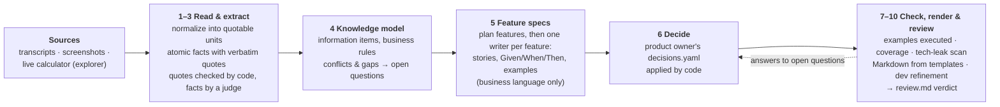

# Requirements pipeline

A generic pipeline of Claude agents and deterministic checks. It turns messy
business sources (meeting transcripts, portal screenshots, live web
calculators) into **feature specs**: user stories with acceptance criteria and
concrete examples, every line traceable to a source quote. The specs say
**what** is needed and **why**. They contain no technical decisions; how to
build it is up to engineering.



Every stage is cached; a changed source or decision reruns only what depends on it.

Deliverables of this run:
- Onboarding feature specs: [`requirements/employee-onboarding/`](requirements/employee-onboarding/README.md)
- Review for the product owner: `build/employee-onboarding/review.md`
- Proof of genericity: [`requirements/address-change/`](requirements/address-change/README.md), a second
  problem that runs through the same engine with **zero code changes**.

## Principles

1. **Proof for every line.** Every story, acceptance criterion, information
   item and rule cites facts; every fact quotes its source verbatim; every
   quote is machine-checked against the source.
2. **Knowledge, not technology.** The output describes what we learned:
   stakeholders' goals, the information they need, when and why, and the
   business rules. Boundary rule: *if a source says it (or the product owner
   decided it), it goes in; if it is a choice about how to build it, it stays
   out.* A deterministic vocabulary scan and the dev-refinement agent flag
   technical decisions that leak in.
3. **Rules before judges.** Everything checkable by code is checked by code:
   quotes, references, the problem's checklist, coverage, and **every example
   in every acceptance criterion is executed** against an internal
   formalisation of the business rules. LLM judges only cover what code
   cannot, one item at a time.
4. **Agents interpret, code decides format.** Agents return JSON validated
   against schemas (`pipeline/engine/schemas.py`); Markdown is rendered from
   templates, never free-written.
5. **The human decides, as data.** Open questions and inferred items surface in
   `review.md`. The product owner answers in `decisions.yaml` (or with
   `/decide`); code applies decisions after the agents ran, cites them, and
   flags them for re-confirmation if their evidence changes.
6. **Generic engine, problem profiles.** Nothing in `pipeline/` knows about
   onboarding. Everything domain-specific lives in `problems/<name>/`.
7. **Cheap, traceable reruns.** Each stage is cached by a fingerprint of all
   its inputs; a changed source reruns only what depends on it. Features are
   written in parallel, one agent each.

## Quick start

```bash
python3.12 -m venv .venv && .venv/bin/pip install -r requirements.txt
.venv/bin/python -m pipeline run                              # onboarding (default problem)
.venv/bin/python -m pipeline --problem address-change run     # any other problem profile
.venv/bin/python -m pipeline status                           # which sources changed since the last run
.venv/bin/python -m pipeline run --fast                       # skip LLM checks while iterating on decisions
.venv/bin/python -m pipeline explore zh_source_tax_calculator # crawl a live calculator (Playwright MCP)
.venv/bin/python -m pipeline publish --dry-run                # Linear sync plan, nothing sent
```

The Agent SDK runs on the local Claude Code login; no API key is needed.

## Layout

```
pipeline/                    GENERIC - never changed for a new problem
  engine/                    schemas, stage cache, Agent SDK wrapper, condition language, decisions
  adapters/<source type>/    adapter.py + agent.md (+ config.yaml): transcript, screenshots, web_calculator
  agents/                    knowledge modeler, feature planner, story writer, judges, dev refinement, reviewer
  checks/mechanical.py       checklist lint, example execution, coverage, tech-leak scan, gold eval
  render/templates/          feature spec, information catalogue, open questions, out of scope, traceability
  publish/linear_plan.py     Linear sync plan (dry run): feature → milestone, story → issue
problems/<name>/             EVERYTHING SPECIFIC to one investigation
  profile.yaml               sources (+ authority, precedence), stakeholders, item checklist, models
  guidance.md                product-owner guidance; [G-nn] items are citable
  decisions.yaml             product decisions (the override layer)
  examples.yaml              named real cases from the sources, executed every run
  gold.yaml                  hand-labelled expectations for the eval
.claude/skills/              /run-pipeline · /decide · /trace · /new-adapter · /new-problem · /learn
build/<problem>/             every intermediate result (units, facts, verdicts, knowledge, features, report, review.md)
requirements/<problem>/      the deliverable: feature specs
```

## Stages: what, why, in → out

| # | Stage | Who | In | Out | Why |
|---|---|---|---|---|---|
| 1 | **normalize** | adapter | raw source | `normalize/<src>.json`: Units with stable ids (`T-031`, `S05-E14`, `C-Q03`) and exact text | Makes sources addressable and quotable. Transcripts are split deterministically; screenshots are transcribed verbatim by a vision agent, twice, with disagreements reported. |
| 2 | **extract** | one agent per source (parallel) | units + source-type prompt + guidance | `extract/<src>.json`: atomic Facts (kind, verbatim anchors, explicit/inferred, desired/current state, supersedes) | Small facts are checkable; stakeholder self-corrections are kept as linked history instead of being merged silently. |
| 3 | **verify** | code + judge agent | facts + units | `facts.json` | Quotes must be exact substrings (code). A narrow judge checks each fact against its units. Unsupported facts never go further. |
| 4 | **knowledge** | agent | verified facts, profile, guidance | `knowledge.raw.json`: information items (what, form, allowed values, when asked, when required, who needs it), business rules with decision tables, open questions, exclusions | One consolidated model of what we know, in business language, plus an internal formalisation (conditions as expressions) used only to verify examples. |
| 5 | **features** | planner agent, then one writer agent per feature (parallel) | knowledge model + cited facts | `features.plan.json`, `features/<id>.json`: features with user stories, acceptance criteria (Given/When/Then) and example tables | The planner slices by the stakeholder goals and pain points the sources state (generic heuristic, no fixed journey). Writing per feature keeps contexts small and reruns local. |
| 6 | **decide** | code (+ human) | spec + `decisions.yaml` | `spec.json` | Human judgment applied as a deterministic patch with the highest precedence. |
| 7 | **check** | code + judge agent | spec, facts, units, examples, gold | findings | Checklist lint (the profile's questions answered for every item), every example executed, coverage both ways (every item/rule covered by a story; every source unit cited or listed), tech-leak scan, gold eval, per-element trace judge. |
| 8 | **render** | code (Jinja) | spec + facts | `requirements/<problem>/` | Fixed, reusable format; evidence inline; internal expressions are never rendered. |
| 9 | **dev refinement** | one agent per feature, reading only the rendered files | `requirements/` | questions engineering would ask + technical leaks | The acceptance test of the task: "built without anyone asking a single question". |
| 10 | **review** | agent | full check report | `review.md`: verdict ready / ready with caveats / not ready | One place for the human. |

## How it makes sure the result is complete and correct

**Correct (nothing invented):** verbatim-quote check on every anchor ·
screenshot double read · fact judge per fact · trace judge per item, rule and
story · every element must cite a valid fact, guideline or decision ·
**every acceptance-criterion example is executed** against the business rules,
plus the named cases in `examples.yaml` (Maria, Tomás, Stefan, Julia, …) ·
guidance forbids outside knowledge; inferred elements are labelled and listed.

**Complete (nothing lost):** the profile's checklist is enforced for every
information item (for this assignment: what, when asked, when required,
depends on, who needs it) · every item and rule is owned by a feature and
covered by a story · uncited source units and unused facts are listed for the
human · gold-set recall/precision · dev-refinement questions.

## Human in the loop

| When | Where | What |
|---|---|---|
| before a run | `profile.yaml`, `guidance.md` | scope, stakeholders, source authority, vocabulary, optional feature constraints |
| after a run | `build/<p>/review.md` | the one file to read |
| deciding | `decisions.yaml` (or `/decide`) | override / add / exclude / resolve / accept / reject, by stable id |
| over time | `/learn` | turn repeated overrides into examples, gold entries, guidance or checks |

## When a source changes, or a new one arrives

1. Replace the file (or rerun `explore` for a live site).
2. `pipeline status` shows which sources changed; `pipeline run` reruns that
   source's chain and everything downstream of it.
3. `review.md` shows failing examples, decisions whose evidence changed
   (flagged for re-confirmation), and coverage of the new content.
4. `git diff requirements/` shows exactly which stories and criteria changed;
   the Linear dry run shows which issues would be updated.

New source type → new adapter folder (`/new-adapter`) + one entry in
`profile.yaml`. New process → new `problems/<name>/` folder (`/new-problem`);
`problems/address-change/` is the minimal example.

See [LIMITATIONS.md](LIMITATIONS.md) for where the pipeline stands.
