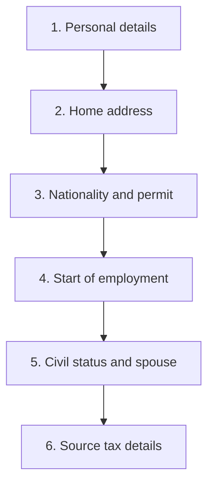

# Onboarding flow

Steps are shown in this order. Within a step, fields are shown in the listed
order. A step or field whose condition is false is skipped entirely (not shown,
no value stored). Conditions are re-evaluated whenever an answer changes; when
a field becomes hidden, its value is discarded.

## 1. Personal details

Identify the employee for the pension fund registration and HR correspondence.

Shown: always

> Let's start with a few details about you.

| # | Field | Asked when | Required when | Needed by |
|---|---|---|---|---|
| 1 | [First name](fields/first_name.md) `first_name` | always | always | pension_fund, employer_hr |
| 2 | [Last name](fields/last_name.md) `last_name` | always | always | pension_fund, employer_hr |
| 3 | [Date of birth](fields/date_of_birth.md) `date_of_birth` | always | always | pension_fund |

## 2. Home address

Collect the full postal address for HR mail. The country also decides source tax liability, and the canton is needed for the pension fund.

Shown: always

> Please enter your home address the way you would write it on an envelope. We post documents to this address.

| # | Field | Asked when | Required when | Needed by |
|---|---|---|---|---|
| 1 | [Street](fields/address_street.md) `address_street` | always | always | employer_hr |
| 2 | [House number](fields/address_house_number.md) `address_house_number` | always | always | employer_hr |
| 3 | [Postcode](fields/address_postcode.md) `address_postcode` | always | always | employer_hr |
| 4 | [Town](fields/address_town.md) `address_town` | always | always | employer_hr |
| 5 | [Country](fields/address_country.md) `address_country` | always | always | employer_hr, source_tax |
| 6 | [Canton](fields/residence_canton.md) `residence_canton` | `address_country == "CH"` | always | pension_fund |

## 3. Nationality and permit

Check whether a Swiss resident is subject to source tax. Only asked of people living in Switzerland, because everyone living abroad is subject to source tax whatever their nationality.

Shown: `address_country == "CH"`

| # | Field | Asked when | Required when | Needed by |
|---|---|---|---|---|
| 1 | [Nationality](fields/nationality.md) `nationality` | `address_country == "CH"` | always | source_tax |
| 2 | [Residence permit](fields/permit_type.md) `permit_type` | `address_country == "CH" and nationality != "CH"` | always | source_tax, employer_hr |

Notices in this step:
- Please bring your residence permit with you on your first working day. (shown `is_set(permit_type)`)

## 4. Start of employment

Confirm the first working day. The pension fund insurance start date is derived from it.

Shown: always

> Please confirm your first working day.

| # | Field | Asked when | Required when | Needed by |
|---|---|---|---|---|
| 1 | [First working day](fields/first_working_day.md) `first_working_day` | always | always | pension_fund, employer_hr |

Notices in this step:
- Your pension fund insurance starts on the 1st of the month on or after your first working day. If your start date changes, please update it here right away. (shown `is_set(first_working_day)`)

## 5. Civil status and spouse

Collect the civil status and spouse's date of birth for the pension fund, and spouse details that can exempt a married employee from source tax.

Shown: always

> The pension fund needs your civil status. If you are married, we also need some details about your spouse.

| # | Field | Asked when | Required when | Needed by |
|---|---|---|---|---|
| 1 | [Civil status](fields/civil_status.md) `civil_status` | always | always | pension_fund, source_tax |
| 2 | [Spouse's date of birth](fields/spouse_date_of_birth.md) `spouse_date_of_birth` | `civil_status == "married"` | always | pension_fund |
| 3 | [Spouse's nationality](fields/spouse_nationality.md) `spouse_nationality` | `civil_status == "married" and address_country == "CH" and nationality != "CH" and permit_type != "C"` | always | source_tax |
| 4 | [Spouse's residence permit](fields/spouse_permit_type.md) `spouse_permit_type` | `civil_status == "married" and address_country == "CH" and nationality != "CH" and permit_type != "C" and spouse_nationality != "CH"` | always | source_tax |
| 5 | [Spouse's country of residence](fields/spouse_residence_country.md) `spouse_residence_country` | `civil_status == "married" and address_country == "CH" and nationality != "CH" and permit_type != "C" and (spouse_nationality == "CH" or spouse_permit_type == "C")` | always | source_tax |

## 6. Source tax details

Collect the inputs for the Zurich source tax tariff calculator. Only shown to employees who are subject to source tax.

Shown: `subject_to_source_tax`

> You are subject to source tax. We need a few more details to determine your tax tariff.

| # | Field | Asked when | Required when | Needed by |
|---|---|---|---|---|
| 1 | [Spouse works](fields/spouse_employed.md) `spouse_employed` | `subject_to_source_tax and civil_status == "married"` | always | source_tax |

## Derived values
- [`subject_to_source_tax`](rules/subject_to_source_tax.md): Whether the employee is subject to source tax. Residents abroad are always subject. Residents of CH are not subject if they are Swiss, hold a C permit, or are married to a Swiss national or C permit holder who lives in CH. Everyone else is subject.
- [`insurance_start_date`](rules/insurance_start_date.md): Pension fund insurance start: the first working day if it is the 1st of a month, otherwise the 1st of the following month.
